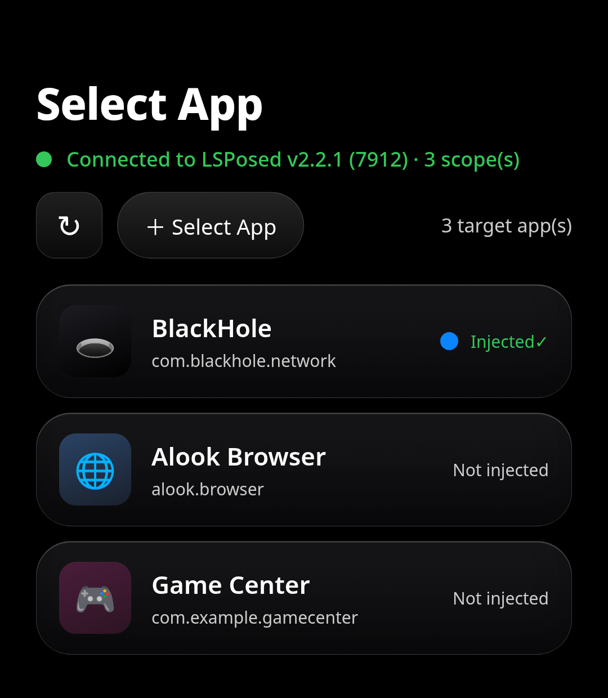
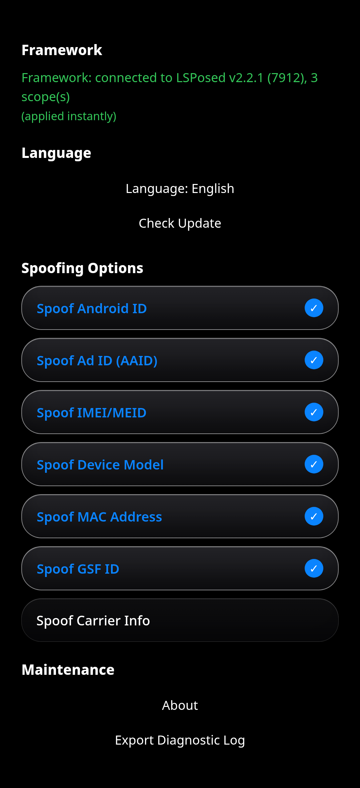

# DeviceResetSpoofer

> 自动识别 **官方 LSPosed** 与 **JingMatrix/Vector** 双分支的设备伪装模块：主页额头显示「已连接 XX」，应用内勾选目标 → 随机/自定义 → 保存即生效
> Device-spoofing module that auto-detects **official LSPosed** and **JingMatrix/Vector**: the home header shows "Connected to XX"; pick targets in-app → Random / Customize → Save, done

[English](#-english) | [中文](#-中文) | [Русский](#-русский)

---

## 📱 Screenshots / 界面预览

| 主界面 / Main（额头显示已连接框架） | 设置界面 / Settings |
|:---:|:---:|
|  |  |

---

## 🇬🇧 English

### Table of Contents
- [Introduction](#introduction)
- [Dual-framework auto-detection](#-dual-framework-auto-detection)
- [Features](#-features)
- [Requirements](#-requirements)
- [Installation](#-installation)
- [Usage](#-usage)
- [How It Works](#-how-it-works)
- [Spoofed Identifiers](#-spoofed-identifiers)
- [FAQ](#-faq)
- [Warnings](#️-warnings)
- [License](#-license)

### Introduction

An LSPosed/Vector module that **spoofs a fresh device identity for the apps you pick, right from inside this app**. It automatically detects which framework you installed (official LSPosed or JingMatrix/Vector), shows **"Connected to XX"** in the home header, and chooses the right scope-writing method. Select a target, tap Random / Customize, Save, and reopen the app: the new identity is applied — no need to open the framework manager.

### 🔀 Dual-framework auto-detection

The two branches share the same directories, process name and database (`/data/adb/lspd`, `pidof lspd`, `modules_config.db`); they differ only in the manager package, CLI and authorization. The module detects all three signals precisely:

| Framework | Manager package | Module id | CLI | Scope write |
|---|---|---|---|---|
| **Official LSPosed** (e.g. v2.2.1-7912) | `org.lsposed.manager` | `zygisk_lsposed` | `lspctl` | Direct DB write + restart daemon (a few seconds) |
| **Vector / JingMatrix** (e.g. v2.2-3080) | `org.matrix.vector.manager` | `zygisk_vector` | `cli` | Instant via `cli` (no restart) |

> Why official LSPosed needs a daemon restart: `lspctl` write commands are gated by developer mode plus a CLI-origin verifier that requires an ADB ancestor process — an unattended app over `su` cannot pass. So the module writes the DB directly and restarts only the `lspd` daemon (**not the phone**). The readiness poll is extended to ~90 s to cover first-time dex2oat; on failure the previous DB is restored automatically so the framework is never left half-activated.

### ✨ Features

- **Auto-detection of both branches**: header shows "Connected to LSPosed / Vector" with version; the correct scheme is picked automatically
- **No framework manager needed**: enable the module once, then add/remove targets and write identities entirely in this app
- **Applies instantly / a few seconds**: Vector applies instantly; official restarts only the daemon for a few seconds — no phone reboot
- **Manual trigger**: adding a target to the list is NOT applying — tap **Random / Customize → Save** in its detail dialog
- **Reliable uncheck**: scope is fully overwritten; removing every target disables the module. Only this module's own rows are touched — other modules are unaffected
- **Sentinel-driven injection**: only processes whose private dir contains a readable `.identity_sentinel` get hooked; everything else is skipped
- **Multi-dimensional spoofing**: Android ID, Advertising ID, IMEI/MEID, IMSI/ICCID, device model, MAC, GSF ID, serial, carrier info — permission-gated methods are short-circuited before the original throws
- **Independent toggles**: each hook item can be enabled/disabled independently
- **Trilingual UI**: Chinese / English / Русский, switch anytime
- **Glass UI**: frosted-glass capsule style, filters, long-press to remove targets

### 📋 Requirements

| Item | Requirement |
|------|-------------|
| **Android Version** | Android 8.0 ~ Android 16 (API 26 ~ 36) |
| **Root Access** | Required |
| **Framework** | Official LSPosed **or** JingMatrix/Vector (auto-detected) |
| **Architecture** | arm64-v8a, armeabi-v7a, x86, x86_64 |
| **Storage** | ~6MB |

### 📦 Installation

1. Download the latest APK from the [Releases](https://github.com/GJR787878/DeviceResetSpoofer/releases) page and install it
2. Open your **framework manager** (LSPosed or Vector) → **Modules** → enable **DeviceResetSpoofer**
3. Open **DeviceResetSpoofer** — the header confirms the connected framework (e.g. "Connected to LSPosed v2.2.1 (7912)")
4. No phone reboot is required

### 🚀 Usage

1. On the **Apps** tab, tap **+ Select App** to pick targets
2. Tap a target row → **Random** or **Customize** → **Save**
3. Reopen the target app — the new identity is applied
4. If the app still reports old values, open its detail → **Clear Data** → reopen directly

> **Tip**: A green "Injected ✓" status means the target is in scope. The list auto-refreshes when apps are installed/uninstalled.

### 🔧 How It Works

- **Vector**: the module calls the bundled `cli` over root; the daemon writes the DB and refreshes its in-memory ConfigCache itself — instant, no restart.
- **Official LSPosed**: the module copies the DB out (root → private dir), edits it with the in-app SQLite, then stops the old daemon, writes the DB back, and starts a new daemon via `daemon --force` (mirroring the official `service.sh`), polling until ready. The system framework is stored as `system` (the package name is `android` at load time).
- In the target process, hooks are installed only when a readable `.identity_sentinel` exists; **Save** is the manual trigger that writes the values and sentinel.

### 🎭 Spoofed Identifiers

- Android ID (SSAID)
- Advertising ID (AAID) / AppSet ID
- IMEI / MEID / IMSI / ICCID
- Serial number / MAC address (incl. `NetworkInterface.getHardwareAddress()`)
- GSF ID
- Device info: Brand, Model, Manufacturer, Build fingerprint, bootloader, radio
- Carrier info: Code, Name, Country

### ❓ FAQ

**Q: Do I need to reboot when I check a new app?**
A: No. With Vector it applies instantly; with official LSPosed only the `lspd` daemon restarts for a few seconds (the phone itself does not reboot). Then reopen the target.

**Q: Will other modules be affected?**
A: No. The module only edits its own rows. On official LSPosed, apps launched during the few-seconds restart may briefly skip injection; already-running apps are unaffected.

**Q: I added the app but nothing changed?**
A: Adding a target only manages the list. Open its detail and tap **Random / Customize → Save** to write the identity.

**Q: The app still reads the old identity?**
A: Some apps cache identity on first launch. Use **Clear Data** in the detail dialog, then reopen directly.

### ⚠️ Warnings

- For **personal privacy protection and technical testing only**
- Some apps detect Xposed/Root traces — **account ban risk exists**
- **Clear Data wipes the target app's own data** — use it only when the identity doesn't refresh
- Apps reading system properties directly at the native layer cannot be intercepted by Java hooks
- Test on non-critical apps first; use **Export Log** in Settings to troubleshoot

### 📄 License

[MIT License](LICENSE)

---

## 🇨🇳 中文

### 目录
- [简介](#简介)
- [双框架自动检测](#-双框架自动检测)
- [功能特性](#-功能特性)
- [系统要求](#-系统要求)
- [安装方法](#-安装方法)
- [使用方法](#-使用方法)
- [工作原理](#-工作原理)
- [伪装的识别码](#-伪装的识别码)
- [常见问题](#-常见问题)
- [注意事项](#️-注意事项)
- [许可证](#-许可证)

### 简介

一个 LSPosed/Vector 模块：**自动识别你装的是官方 LSPosed 还是 JingMatrix/Vector**，主页额头显示「已连接 XX」，并自动选择对应方案。在本应用内选择目标，随机/自定义，保存后重新打开目标即生效，无需再打开框架管理器。

### 🔀 双框架自动检测

两个分支的目录、进程名、数据库完全相同（`/data/adb/lspd`、`pidof lspd`、`modules_config.db`），区别只在管理器包名、CLI 和鉴权。模块会精确检测三路信号：

| 框架 | 管理器包名 | 模块 id | CLI | 作用域写入 |
|---|---|---|---|---|
| **官方 LSPosed**（如 v2.2.1-7912） | `org.lsposed.manager` | `zygisk_lsposed` | `lspctl` | 直写库 + 重启守护进程（几秒） |
| **Vector / JingMatrix**（如 v2.2-3080） | `org.matrix.vector.manager` | `zygisk_vector` | `cli` | 经 `cli` 即时生效（无重启） |

> 为什么官方需要重启守护进程：`lspctl` 的写命令被开发者模式 + CLI 来源校验（要求进程祖先链含 adbd、有 ADB 连接）挡住，App 经 su 无人值守无法通过。因此模块直写库后只重启 `lspd` 守护进程（**不是重启手机**）；就绪轮询放宽到约 90 秒以覆盖首次 dex2oat，失败时自动恢复旧库，绝不把框架留在半激活状态。

### ✨ 功能特性

- **双分支自动检测**：额头显示「已连接 LSPosed / Vector」及版本，自动选择对应方案
- **免开框架管理器**：仅启用一次模块，之后增删目标、写伪装值全部在本应用内完成
- **即时 / 几秒生效**：Vector 即时；官方只重启几秒守护进程，不重启手机
- **手动触发**：把应用加入目标列表 ≠ 生效；需在详情弹窗点击**随机/自定义 → 保存**
- **取消勾选可靠**：作用域全量覆盖，一个目标都不剩则禁用模块；只操作本模块自己的行，其他模块不受影响
- **哨兵驱动注入**：只有私有目录存在可读 `.identity_sentinel` 的进程才注入 Hook，其余跳过
- **多维度伪装**：Android ID、广告 ID、IMEI/MEID、IMSI/ICCID、设备型号、MAC、GSF ID、序列号、运营商；受权限门限制的方法在原方法抛异常前短路
- **独立开关**：各 Hook 项可独立开启/关闭
- **三语界面**：中文 / English / Русский
- **玻璃胶囊 UI**：毛玻璃风格，支持筛选、长按删除目标

### 📋 系统要求

| 项目 | 要求 |
|------|------|
| **Android 版本** | Android 8.0 ~ Android 16（API 26 ~ 36） |
| **Root 权限** | 必须 |
| **框架** | 官方 LSPosed **或** JingMatrix/Vector（自动检测） |
| **架构** | arm64-v8a, armeabi-v7a, x86, x86_64 |
| **存储空间** | 约 6MB |

### 📦 安装方法

1. 前往 [Releases](https://github.com/GJR787878/DeviceResetSpoofer/releases) 下载最新版 APK 并安装
2. 打开**框架管理器**（LSPosed 或 Vector）→ **模块** → 启用 **DeviceResetSpoofer**
3. 打开 **DeviceResetSpoofer**，额头会确认已连接框架（如「已连接 LSPosed v2.2.1 (7912)」）
4. 无需重启手机

### 🚀 使用方法

1. 在 **Apps** 页点击 **+ Select App** 选择目标
2. 点击目标行 → **随机** 或 **自定义** → **保存**
3. 重新打开目标应用即生效
4. 若仍读到旧值，打开详情 → **清空数据** → 直接重新打开

> **提示**：绿色「已注入✓」表示目标已在作用域；系统有新装/卸载时列表自动更新。

### 🔧 工作原理

- **Vector**：模块经 root 调用自带 `cli`，由守护进程自己写库并刷新内存 ConfigCache——即时、无重启。
- **官方 LSPosed**：模块把库拷出（root → 私有目录），用应用内 SQLite 编辑，然后停旧守护、写回库、用 `daemon --force`（复刻官方 `service.sh`）拉起新守护并轮询就绪。系统框架存为 `system`（加载时包名才是 `android`）。
- 在目标进程内，只有存在可读 `.identity_sentinel` 才装 Hook；**保存**是手动触发，写入值并落哨兵。

### 🎭 伪装的识别码

- Android ID（SSAID）
- 广告 ID（AAID）/ AppSet ID
- IMEI / MEID / IMSI / ICCID
- 序列号 / MAC 地址（含 `NetworkInterface.getHardwareAddress()`）
- GSF ID
- 设备信息：品牌、型号、厂商、Build 指纹、bootloader、radio
- 运营商信息：代码、名称、国家

### ❓ 常见问题

**Q：每次勾选新应用都要重启吗？**
A：不用。Vector 即时生效；官方 LSPosed 只重启 `lspd` 守护进程几秒（手机本身不重启），然后重新打开目标即可。

**Q：手机里的其他模块会受影响吗？**
A：不会。模块只改自己的行。官方 LSPosed 重启的几秒内，新启动的应用可能短暂不注入；已运行的应用不受影响。

**Q：把应用加入列表了，为什么没生效？**
A：加入目标只是管理列表。打开详情点击**随机/自定义 → 保存**才会写入身份。

**Q：保存后仍读到旧值？**
A：部分应用首次启动缓存身份。在详情弹窗使用**清空数据**，然后直接重新打开。

### ⚠️ 注意事项

- 本模块**仅用于个人隐私保护和技术测试**
- 部分应用会检测 Xposed/Root 痕迹，**存在账号封禁风险**
- **清空数据会清除目标应用自身数据**，仅在身份刷新不了时使用
- native 层直接读取系统属性的应用，Java 层 Hook 无法拦截
- 建议先在不重要的应用上测试；设置页可用「导出日志」排查

### 📄 许可证

[MIT License](LICENSE)

---

## 🇷🇺 Русский

### Содержание
- [Введение](#введение)
- [Автоопределение двух фреймворков](#-автоопределение-двух-фреймворков)
- [Возможности](#-возможности)
- [Требования](#-требования)
- [Установка](#-установка)
- [Использование](#-использование)
- [Как это работает](#-как-это-работает)
- [Подделываемые идентификаторы](#-подделываемые-идентификаторы)
- [Часто задаваемые вопросы](#-часто-задаваемые-вопросы)
- [Предупреждения](#️-предупреждения)
- [Лицензия](#-лицензия)

### Введение

Модуль LSPosed/Vector, который **подделывает идентичность устройства для выбранных приложений прямо из этого приложения**. Он автоматически определяет установленный фреймворк (официальный LSPosed или JingMatrix/Vector), показывает **«Подключено к XX»** в шапке и выбирает нужный способ записи области. Выберите цель, нажмите «Случайно»/«Настроить», сохраните и снова откройте приложение — менеджер фреймворка открывать не нужно.

### 🔀 Автоопределение двух фреймворков

Обе ветки используют одинаковые каталоги, имя процесса и базу (`/data/adb/lspd`, `pidof lspd`, `modules_config.db`); различия — только в пакете менеджера, CLI и авторизации. Модуль точно определяет все три сигнала:

| Фреймворк | Пакет менеджера | id модуля | CLI | Запись области |
|---|---|---|---|---|
| **Официальный LSPosed** (напр. v2.2.1-7912) | `org.lsposed.manager` | `zygisk_lsposed` | `lspctl` | Прямая запись БД + перезапуск демона (несколько секунд) |
| **Vector / JingMatrix** (напр. v2.2-3080) | `org.matrix.vector.manager` | `zygisk_vector` | `cli` | Мгновенно через `cli` (без перезапуска) |

> Почему официальному LSPosed нужен перезапуск демона: команды записи `lspctl` защищены режимом разработчика и проверкой источника CLI, требующей процесс-предок adbd — приложение без участия пользователя через `su` пройти не может. Поэтому модуль пишет БД напрямую и перезапускает только демон `lspd` (**не телефон**). Опрос готовности продлён до ~90 с для покрытия первого dex2oat; при сбое прежняя БД восстанавливается автоматически.

### ✨ Возможности

- **Автоопределение обеих веток**: в шапке «Подключено к LSPosed / Vector» с версией, схема выбирается автоматически
- **Без менеджера фреймворка**: включите модуль один раз, затем добавление/удаление целей и запись идентичности — в этом приложении
- **Мгновенно / несколько секунд**: Vector мгновенно; официальный перезапускает только демон на несколько секунд — без перезагрузки телефона
- **Ручной запуск**: добавление в список ≠ применение — нажмите **«Случайно»/«Настроить» → Сохранить**
- **Надёжное снятие отметки**: область полностью перезаписывается; при отсутствии целей модуль отключается. Затрагиваются только строки этого модуля
- **Инъекция по сторожевому файлу**: хуки ставятся только при наличии читаемого `.identity_sentinel`
- **Многомерная подделка**: Android ID, рекламный ID, IMEI/MEID, IMSI/ICCID, модель, MAC, GSF ID, серийный номер, оператор — методы с правами перехватываются до исключения
- **Независимые переключатели**, трёхъязычный интерфейс, стеклянный UI

### 📋 Требования

| Пункт | Требование |
|------|-------------|
| **Версия Android** | Android 8.0 ~ Android 16 (API 26 ~ 36) |
| **Root** | Обязателен |
| **Фреймворк** | Официальный LSPosed **или** JingMatrix/Vector (автоопределение) |
| **Архитектура** | arm64-v8a, armeabi-v7a, x86, x86_64 |
| **Хранилище** | ~6 МБ |

### 📦 Установка

1. Скачайте последний APK со страницы [Releases](https://github.com/GJR787878/DeviceResetSpoofer/releases) и установите
2. Откройте **менеджер фреймворка** (LSPosed или Vector) → **Модули** → включите **DeviceResetSpoofer**
3. Откройте **DeviceResetSpoofer** — шапка подтвердит подключённый фреймворк
4. Перезагрузка телефона не требуется

### 🚀 Использование

1. На вкладке **Apps** нажмите **+ Select App** и выберите цели
2. Нажмите на строку → **«Случайно»** или **«Настроить»** → **Сохранить**
3. Снова откройте целевое приложение
4. При старых значениях откройте детали → **Очистить данные** → откройте напрямую

> **Совет**: Зелёное «Внедрено✓» означает, что цель в области.

### 🔧 Как это работает

- **Vector**: модуль вызывает `cli` через root; демон сам пишет БД и обновляет ConfigCache — мгновенно.
- **Официальный LSPosed**: БД копируется (root → личный каталог), редактируется встроенным SQLite, затем старый демон останавливается, БД записывается, новый демон запускается через `daemon --force` (по образцу `service.sh`) с опросом готовности. Системный фреймворк хранится как `system`.
- В процессе цели хуки ставятся только при наличии читаемого `.identity_sentinel`; **Сохранить** — ручной запуск.

### 🎭 Подделываемые идентификаторы

- Android ID (SSAID)
- Рекламный ID (AAID) / AppSet ID
- IMEI / MEID / IMSI / ICCID
- Серийный номер / MAC (включая `NetworkInterface.getHardwareAddress()`)
- GSF ID
- Устройство: бренд, модель, производитель, отпечаток, bootloader, radio
- Оператор: код, название, страна

### ❓ Часто задаваемые вопросы

**Q: Нужно ли перезагружаться при выборе нового приложения?**
A: Нет. Vector применяет мгновенно; официальный LSPosed перезапускает только демон `lspd` на несколько секунд (телефон не перезагружается), затем откройте цель.

**Q: Повлияют ли другие модули?**
A: Нет. Редактируются только строки этого модуля. На официальном LSPosed приложения, запущенные в течение нескольких секунд перезапуска, могут кратко пропустить инъекцию; уже запущенные не затрагиваются.

**Q: Добавил приложение, но ничего не изменилось?**
A: Добавление только управляет списком. Откройте детали и нажмите **«Случайно»/«Настроить» → Сохранить**.

**Q: Приложение читает старую идентичность?**
A: Используйте **Очистить данные** в диалоге деталей, затем откройте напрямую.

### ⚠️ Предупреждения

- Только для **защиты конфиденциальности и технического тестирования**
- Часть приложений обнаруживает Xposed/Root — **риск блокировки аккаунта**
- **Очистка данных удаляет данные приложения** — используйте только при необходимости
- Нативное чтение системных свойств не перехватывается Java-хуками
- Сначала тестируйте на некритичных приложениях; используйте «Экспорт журнала»

### 📄 Лицензия

[MIT License](LICENSE)

---

## ⭐ Support

If this project helps you, please give it a Star ⭐

For issues or suggestions, please submit an [Issue](https://github.com/GJR787878/DeviceResetSpoofer/issues).
